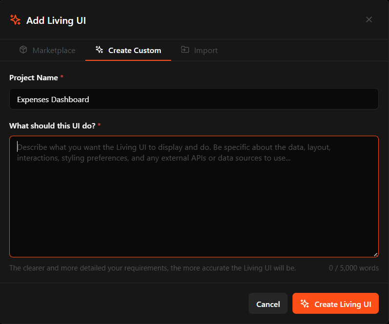
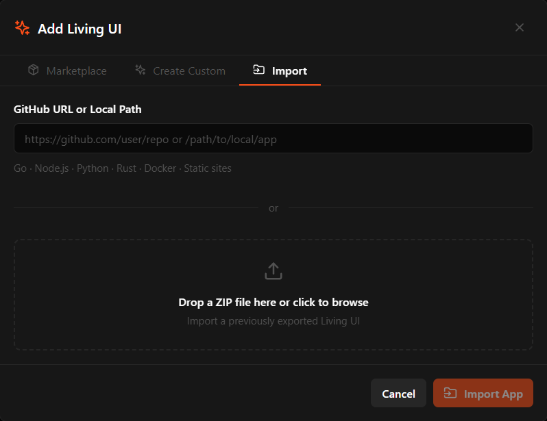

<div align="center">
    
</div>

La plupart des harnais d'agents s'arrêtent au chat et aux appels d'outils. CraftBot va plus loin : il construit, fait évoluer et opère ses propres outils SaaS, puis se sert de cette couche d'outils pour communiquer avec vous et automatiser vos tâches.

Au-delà de cela, CraftBot dispose de toutes les capacités essentielles d'un harnais d'agent généraliste. Il exécute des tâches comme le ferait un employé à distance, retient vos préférences et vos objectifs, et vous aide de manière proactive à planifier et à agir sur ce qui compte vraiment pour vous.

<p align="center">
  
  
  


  <a href="https://github.com/CraftOS-dev/CraftBot">
    
  </a>

  

  <a href="https://discord.gg/ZN9YHc37HG">
    
  </a>

  <a href="https://deepwiki.com/CraftOS-dev/CraftBot">
    
  </a>
</p>

<div align="center">
	
[](https://e2b.dev/startups)
</div>

<p align="center">
  <a href="README.md">English</a> | <a href="README.ja.md">日本語</a> | <a href="README.cn.md">简体中文</a> | <a href="README.zh-TW.md">繁體中文</a> | <a href="README.ko.md">한국어</a> | <a href="README.es.md">Español</a> | <a href="README.pt-BR.md">Português</a> | <a href="README.de.md">Deutsch</a>
</p>

## ✨ Fonctionnalités phares

En plus d'être un agent IA capable de créer et d'opérer ses propres outils SaaS, CraftBot embarque toutes les fonctionnalités de base d'un harnais d'agent, ce qui lui permet de fonctionner comme un agent IA généraliste qui vous accompagne au quotidien sur vos tâches, vos outils, votre mémoire et vos workflows.

- **Profils d'agent** Plus de 40 profils d'agent (agent CEO, agent finance, agent responsable marketing, ingénieur DevOps, agent producteur vidéo, et 37 autres) prêts à travailler pour vous. Trouvez les rôles souhaités dans **[CraftBot Agent Bundles](https://github.com/CraftOS-dev/craftbot-agent-bundles)** et importez-les en un clic.
- **Catalogue de playbooks** Vous ne savez pas comment automatiser avec un agent IA ? CraftBot propose 120 playbooks prêts à l'emploi (répartis sur 19 catégories). Ouvrez le sélecteur de playbooks depuis la barre supérieure, choisissez un playbook, et il commence à exécuter la tâche pour vous.
- **Agent App.** Construisez, importez ou faites évoluer des applications personnalisées qui vivent à l'intérieur de CraftBot. L'agent est en permanence au courant de l'état de l'UI et peut lire, écrire et agir directement sur ses données.
- **Multi-tâches et routage de sessions.** Vous tapez encore `/new` à la main ? CraftBot sait quand démarrer une nouvelle session et quand reprendre une tâche, en gardant la conversation et le contexte unifiés.
- **Auto-hébergé et BYOK.** Système de fournisseurs LLM flexible qui prend en charge OpenAI, Google Gemini, Anthropic Claude, OpenRouter et plus encore. Ou hébergez votre propre modèle, sans dépenser un seul token, avec Ollama.
- **Système de mémoire.** Un second cerveau construit à partir de vos échanges avec CraftBot. Approche hybride : RAG + graphe de connaissances + système de fichiers de l'agent. À minuit, CraftBot « rêve » et consolide les événements survenus dans la journée.
- **Agent proactif.** Il apprend vos préférences, vos habitudes et vos objectifs de vie. Puis il planifie et déclenche des tâches (avec votre accord, bien sûr) pour vous aider à progresser.
- **Intégration d'outils externes.** Connectez vos applications comme Google Workspace, Slack, Notion, Zoom, LinkedIn, Discord, Telegram et bien plus (et bien d'autres à venir !) avec la prise en charge d'OAuth ou votre propre clé. Vous pouvez connecter plusieurs comptes à chaque intégration.
- **Skills et MCP.** Plus de 150 MCP et 170 Skills disponibles. Installation rapide de nouveaux Skills et MCP. Créez ou améliorez des Skills à partir de tâches terminées en un clic.
- **Navigateur ou terminal.** Utilisez CraftBot comme il vous convient le mieux : via une UI navigateur simple pour un usage quotidien, ou via l'édition terminal complète (`python run.py --tui`) avec les mêmes discussions, réglages et Agent Apps.

---


## 🧰 Pour commencer

**Prérequis**

- Windows 10 ou 11 (x64), macOS 12 ou ultérieur (Apple Silicon ou Intel), ou Linux (x86_64 ou ARM64)
- Au moins 5 Go d'espace disque libre
- Une clé API d'un fournisseur de LLM comme OpenAI, Anthropic, Google Gemini ou OpenRouter, ou un modèle local servi par Ollama
- Pour l'installation depuis les sources uniquement : Python 3.8 ou ultérieur. Node.js n'est pas nécessaire.

### Option 1 : installateur (recommandé, sans Python ni Git)

Téléchargez le fichier correspondant à votre système depuis la [dernière version publiée](https://github.com/CraftOS-dev/CraftBot/releases/latest) :

| Système | Fichier |
|---|---|
| Windows (x64) | `CraftBotInstaller-windows.exe` |
| macOS (Apple Silicon et Intel) | `CraftBotInstaller-macos.zip` |
| Linux (x86_64) | `CraftBotInstaller-linux-x86_64` |
| Linux (ARM64) | `CraftBotInstaller-linux-aarch64` |

Ouvrez-le et cliquez sur **Install CraftBot**. L'installateur télécharge tout ce dont CraftBot a besoin, le démarre et l'ouvre dans votre navigateur.

Les installateurs ne sont pas encore signés, le premier lancement demande donc une étape supplémentaire :

- **Windows :** si SmartScreen affiche « Windows a protégé votre ordinateur », cliquez sur **Informations complémentaires** (More info), puis sur **Exécuter quand même** (Run anyway).
- **macOS :** décompressez le fichier et ouvrez `CraftBotInstaller.app`. Sous macOS 15 ou ultérieur, la première ouverture est bloquée : ouvrez **Réglages Système > Confidentialité et sécurité**, cliquez sur **Ouvrir quand même** (Open Anyway) à côté du message concernant CraftBotInstaller, puis confirmez. Sous macOS 12 à 14, faites un clic droit sur l'app et choisissez **Ouvrir** (Open).
- **Linux :** rendez le fichier exécutable et lancez-le depuis une session de bureau (sur un serveur sans bureau, utilisez l'installation depuis les sources) :
  ```bash
  chmod +x CraftBotInstaller-linux-x86_64
  ./CraftBotInstaller-linux-x86_64
  ```

### Option 2 : installation depuis les sources

N'importe quel Python 3.8 ou ultérieur déjà présent sur votre ordinateur convient. CraftBot télécharge son propre Python 3.10 et son propre Node.js 24, et ne modifie jamais le Python ou le Node.js installés sur votre système.

```bash
git clone --depth 1 https://github.com/CraftOS-dev/CraftBot.git
cd CraftBot
```

Lancez ensuite la commande d'installation pour votre système :

```bash
# Windows
python craftbot.py install        # ou : py craftbot.py install

# macOS et Linux
python3 craftbot.py install
```

- **Pas de Git ?** Sur la [page du dépôt](https://github.com/CraftOS-dev/CraftBot), cliquez sur **Code > Download ZIP**, décompressez l'archive, ouvrez un terminal dans le dossier décompressé et lancez la même commande.
- **Pas de Python, ou une version antérieure à 3.8 ?** Utilisez l'installateur (option 1).

La première installation télécharge environ 1 Go, ce qui prend quelques minutes avec une connexion courante. À la fin, CraftBot tourne en arrière-plan, ouvre http://localhost:7925 dans votre navigateur et crée un raccourci sur le bureau. Si le port 7925 ou 7926 est déjà utilisé, CraftBot choisit les ports libres suivants et affiche l'adresse à ouvrir.

Au premier démarrage, l'onboarding dans le navigateur vous demande votre clé API LLM. CraftBot l'enregistre dans `app/config/settings.json` (modifiable plus tard dans les Réglages) et ne lit jamais de clé API depuis un fichier `.env`.

### Gérer CraftBot

Utilisez la même commande `python` ou `python3` que pour l'installation :

```bash
python craftbot.py start      # Démarrer CraftBot en arrière-plan
python craftbot.py stop       # Arrêter CraftBot
python craftbot.py restart    # Redémarrer CraftBot
python craftbot.py status     # Vérifier s'il tourne et si le démarrage automatique est actif
python craftbot.py logs       # Afficher les 50 dernières lignes du journal (davantage avec logs -n 200)
python craftbot.py uninstall  # Arrêter, retirer le démarrage automatique et désinstaller les paquets
python run.py --tui           # Lancer dans le terminal plutôt que dans le navigateur
```

Avec l'installateur, les mêmes actions sont disponibles dans sa fenêtre (**Start**, **Stop**, **Repair**, **Uninstall**).

> [!TIP]
> Après `install` ou `start`, un **raccourci CraftBot sur le bureau** est créé automatiquement. Si vous fermez le navigateur, double-cliquez sur le raccourci pour le rouvrir.

---

## 🌱 Agent App

**Agent App est un système/une application/un tableau de bord qui évolue avec vos besoins.**

<div align="center">
    
</div>

- Besoin d'un tableau kanban avec un copilote IA intégré ?
- D'un CRM sur mesure, conçu exactement à la forme de votre workflow ?
- D'un tableau de bord d'entreprise que CraftBot puisse lire et piloter pour vous ?

Lancez-le comme une Agent App : elle tourne aux côtés de CraftBot et grandit au rythme de vos besoins.

### Trois façons de créer une Agent App

1. **Construire de zéro.** Décrivez ce que vous voulez en langage naturel. CraftBot
   échafaude le modèle de données, l'API back-end et l'UI React, puis itère avec
   vous à travers un processus de conception structuré.

<div align="center">
    
</div>

2. **Installer depuis le marketplace.** Parcourez les Agent Apps créées par la communauté sur [living-ui-marketplace](https://github.com/CraftOS-dev/living-ui-marketplace).

<div align="center">
    
</div>

3. **Importer un projet existant.** Pointez CraftBot vers un projet en Go, Node.js, Python,
   Rust, du code source statique ou un dépôt GitHub. Il détecte le runtime, configure les health checks et l'enveloppe dans une Agent App.

<div align="center">
    
</div>

### Continue d'évoluer avec CraftBot dans la boucle

Une Agent App n'est jamais « finie ». Demandez à l'agent d'ajouter des fonctionnalités,
de redessiner une vue ou de la brancher à de nouvelles données au fur et à mesure que vos besoins évoluent.

CraftBot est intégré à chaque Agent App et **conscient de son état** :
il peut lire le DOM courant et les valeurs des formulaires, interroger les données de l'app via
l'API REST et déclencher des actions en votre nom.

### Garde les outils SaaS ouverts et vivants

Construisez, personnalisez et faites évoluer votre propre Agent App, et dépendez moins des outils par abonnement qui n'ont jamais été pensés pour coller parfaitement à vos besoins.

---
 
# Trois Agent Apps à essayer en 5 minutes
 
- **📋 Tableau Kanban** : toutes les tâches, suivis et CTA au même endroit. CraftBot peut s'en charger et faire le travail de PM pour vous.
- **📊 Habit Tracker** : mettez en place et suivez vos habitudes. Un calendrier d'activité façon GitHub pour suivre vos habitudes comme on suit ses commits.
- **🐦 Luolinglo** : ce n'est pas Duolingo, mais vous pouvez y apprendre de nouvelles langues, créer des flashcards et vous entraîner avec CraftBot.

**[Parcourez le marketplace de Agent App et contribuez-y →](https://craftos.net/marketplace)**

---

## 🔧 Dépannage et problèmes courants

**Commencez par le journal.** `python craftbot.py logs` affiche les 50 dernières lignes (davantage avec `logs -n 200`). Lorsque `install` ou `start` échoue, la commande affiche la fin du journal et se termine avec une erreur. `python craftbot.py doctor` vérifie chaque étape de l'installation sans rien modifier. Dans l'installateur, cliquez sur **Open log**.

**Relancer l'installation ne pose aucun risque.** `python craftbot.py install` saute les étapes déjà réussies et ne réessaie que les autres. Dans l'installateur, cliquez sur **Repair**.

### Les ports 7925 ou 7926 sont déjà utilisés

CraftBot passe aux ports libres suivants et affiche l'adresse à ouvrir. Pour choisir les ports vous-même :

```bash
python craftbot.py start --frontend-port 8925 --backend-port 8926
```

### Proxy ou réseau d'entreprise

Tous les téléchargements (Python, pip, npm, Node.js) utilisent les variables de proxy standard. Définissez-les dans le même terminal avant l'installation :

```bash
# macOS et Linux
export HTTPS_PROXY=http://proxy.example.com:8080
export HTTP_PROXY=http://proxy.example.com:8080
export NO_PROXY=localhost,127.0.0.1
python3 craftbot.py install
```

```powershell
# Windows PowerShell
$env:HTTPS_PROXY = "http://proxy.example.com:8080"
$env:HTTP_PROXY = "http://proxy.example.com:8080"
$env:NO_PROXY = "localhost,127.0.0.1"
python craftbot.py install
```

Les réseaux qui inspectent le trafic TLS ne demandent aucune étape supplémentaire : CraftBot fait confiance aux certificats du magasin de certificats de votre système d'exploitation.

### Téléchargements lents ou bloqués (par exemple en Chine continentale)

Avant l'installation, redirigez les téléchargements vers des miroirs :

| Variable | Usage | Exemple |
|---|---|---|
| `PIP_INDEX_URL` | Paquets Python | `https://pypi.tuna.tsinghua.edu.cn/simple` |
| `npm_config_registry` | Paquets npm | `https://registry.npmmirror.com` |
| `HF_ENDPOINT` | Modèle d'embeddings | `https://hf-mirror.com` |
| `CRAFTBOT_MIRRORS` | Téléchargements de Python, Node.js, PocketBase et du modèle d'embeddings | voir ci-dessous |

`CRAFTBOT_MIRRORS` est une liste de réécritures d'URL au format `prefix=replacement` (préfixe=remplacement), séparées par des points-virgules :

```bash
export CRAFTBOT_MIRRORS="https://github.com/=https://<your-github-proxy>/https://github.com/;https://nodejs.org/dist/=https://npmmirror.com/mirrors/node/"
```

Les paquets Python, les environnements d'exécution Python et Node.js et le modèle d'embeddings de la mémoire sont vérifiés avec des sommes de contrôle SHA-256 épinglées : un miroir ne peut donc pas les modifier. Dans Windows PowerShell, définissez les variables avec `$env:NAME = "value"` au lieu de `export`.

### Serveur sans bureau

Installez depuis les sources sur le serveur sans ouvrir de navigateur :

```bash
python3 craftbot.py install --no-open-browser
```

CraftBot écoute sur `localhost` et n'accepte que les connexions de navigateur adressées à `localhost`. Pour l'utiliser depuis votre propre ordinateur, ouvrez un tunnel SSH qui redirige les deux ports avec les mêmes numéros, puis ouvrez http://localhost:7925 sur votre ordinateur :

```bash
ssh -L 7925:localhost:7925 -L 7926:localhost:7926 user@server
```

`CRAFTBOT_BIND_HOST` fait écouter CraftBot sur une autre interface réseau (l'image Docker utilise `0.0.0.0`). Pour l'accès à distance, le tunnel SSH reste la méthode prévue.

### Linux : CraftBot ne démarre pas après un redémarrage

Le démarrage automatique est un service utilisateur systemd ; il a donc besoin d'une session utilisateur systemd. Pour que CraftBot démarre au boot sans ouverture de session et continue de tourner après la déconnexion, activez le lingering une fois :

```bash
loginctl enable-linger $USER
```

Sans systemd (par exemple WSL sans systemd activé), lancez `python3 craftbot.py start` après chaque démarrage.

### macOS : l'installateur est bloqué

L'installateur n'est pas encore signé. Sous macOS 15 ou ultérieur, essayez de l'ouvrir une fois, puis ouvrez **Réglages Système > Confidentialité et sécurité** et cliquez sur **Ouvrir quand même** (Open Anyway). Sous macOS 12 à 14, faites un clic droit sur l'app et choisissez **Ouvrir** (Open).

### Windows : SmartScreen bloque l'installateur

Cliquez sur **Informations complémentaires** (More info), puis sur **Exécuter quand même** (Run anyway). L'avertissement apparaît parce que l'installateur n'est pas encore signé.

### Windows : `python` ouvre le Microsoft Store

Python n'est pas installé. Utilisez l'installateur, ou installez Python depuis [python.org](https://www.python.org/downloads/) puis lancez `py craftbot.py install`.

### Stocker les données de CraftBot ailleurs

Avant l'installation, définissez `CRAFTBOT_HOME` sur un dossier pour y conserver toutes les données de CraftBot et les environnements d'exécution téléchargés, par exemple sur un disque plus grand. Le démarrage automatique conserve ce réglage.

### Fonctions de navigateur (Playwright)

Le Mini Browser et l'automatisation du navigateur utilisent le Chromium de Playwright. Si son téléchargement échoue, le reste de CraftBot fonctionne quand même. Relancez `python craftbot.py install` plus tard pour réessayer.

---

## 🐳 Lancer dans un conteneur

L'image Docker exécute CraftBot en mode navigateur avec tout le nécessaire préinstallé : Python 3.10 et ses dépendances verrouillées, Node.js 24, l'interface du navigateur, PocketBase et le Chromium de Playwright.

Depuis la racine du dépôt :

```bash
docker compose up -d
```

La première construction prend plusieurs minutes. Ouvrez ensuite http://localhost:7925 et saisissez votre clé API LLM dans l'onboarding.

Les réglages et clés API, les fichiers de l'agent, la mémoire et les journaux sont conservés dans le volume `craftbot-data` : ils survivent aux redémarrages et aux reconstructions de l'image.

```bash
docker compose logs -f craftbot              # Suivre le journal
docker compose ps                            # État, y compris le contrôle de santé
docker compose down                          # Arrêter (le volume de données est conservé)
git pull && docker compose up -d --build     # Mettre à jour vers la dernière version
```

- Les ports ne sont publiés que sur `127.0.0.1`, car l'interface de CraftBot n'a pas de connexion propre. Sur un serveur distant, gardez ce réglage et connectez-vous via le tunnel SSH décrit dans la section Dépannage. Conservez les ports 7925 et 7926 côté hôte : CraftBot n'accepte sur ces ports que les connexions de navigateur adressées à `localhost`.
- Les réglages de proxy et de miroirs (`HTTPS_PROXY`, `PIP_INDEX_URL`, `HF_ENDPOINT`, `CRAFTBOT_MIRRORS` et les autres listés dans `.env.example`) sont transmis au conteneur lorsqu'ils sont définis dans votre shell ou dans un fichier `.env` à côté de `docker-compose.yml`.
- Les Agent Apps tournent sur les ports 3100 à 3199 dans le conteneur et ne peuvent pas encore être ouvertes depuis le navigateur de l'hôte. Pour travailler avec des Agent Apps, utilisez l'installateur ou l'installation depuis les sources.
- Sans Compose :
  ```bash
  docker build -t craftbot .
  docker run -d --name craftbot -p 127.0.0.1:7925:7925 -p 127.0.0.1:7926:7926 --shm-size 1g -v craftbot-data:/data craftbot
  ```

---

## 🤝 Comment contribuer

Les PRs sont les bienvenus ! Le workflow (fork → branche depuis `dev` → PR) est détaillé dans [CONTRIBUTING.md](CONTRIBUTING.md). Toutes les pull requests passent automatiquement par une CI de lint + smoke test.

> [!IMPORTANT]
> **CraftBot** est en développement actif, avec des améliorations chaque semaine. Pour toute question ou un échange plus rapide, rejoignez-nous sur [Discord](https://discord.gg/ZN9YHc37HG) ou écrivez à thamyikfoong(at)craftos.net.

---

## 🧾 Licence

Ce projet est distribué sous [Licence MIT](LICENSE). Vous êtes libre de l'utiliser, de l'héberger et de le monétiser (en cas de distribution ou de monétisation, vous devez créditer ce projet).

---

## ⭐ Remerciements

Développé et maintenu par [CraftOS](https://craftos.net/) et ses contributeurs.  
Si **CraftBot** vous est utile, mettez une ⭐ au dépôt et partagez-le autour de vous !

---

## Historique des stars

<a href="https://star-history.dera.page/#CraftOS-dev/CraftBot&type=date&legend=top-left">
 <picture>
   <source media="(prefers-color-scheme: dark)" srcset="https://star-history.dera.page/svg?repos=CraftOS-dev/CraftBot&type=date&theme=dark&legend=top-left" />
   <source media="(prefers-color-scheme: light)" srcset="https://star-history.dera.page/svg?repos=CraftOS-dev/CraftBot&type=date&legend=top-left" />
   
 </picture>
</a>
