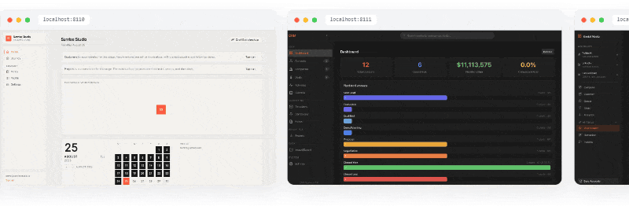

<div align="center">
    
</div>

Most agent harnesses stop at chat and tool calls. CraftBot goes further than that. It builds, evolves, and operates its own SaaS tools, then uses that tool layer to communicate and automate with you.

Beyond that, CraftBot has all the core capabilities of a general-purpose agent harness. It executes tasks the way a remote employee would, remembers your preferences and goals, and proactively helps you plan and act on what matters to you.

<p align="center">
  
  
  


  <a href="https://github.com/CraftOS-dev/CraftBot">
    
  </a>

  

  <a href="https://discord.gg/ZN9YHc37HG">
    
  </a>

  <a href="https://deepwiki.com/CraftOS-dev/CraftBot">
    
  </a>
</p>

<div align="center">
	
[](https://e2b.dev/startups)
</div>

<p align="center">
  <a href="README.ja.md">日本語</a> | <a href="README.cn.md">简体中文</a> | <a href="README.zh-TW.md">繁體中文</a> | <a href="README.ko.md">한국어</a> | <a href="README.es.md">Español</a> | <a href="README.pt-BR.md">Português</a> | <a href="README.fr.md">Français</a> | <a href="README.de.md">Deutsch</a>
</p>

## ✨ Highlighted Features

Aside from being an AI agent that can create and operate its own SaaS tools, CraftBot includes all the core features of an agent harness, enabling it to work as a general AI agent alongside you across your tasks, tools, memory, and daily workflows.

- **Agent Profiles** 40+ Agent Profiles (CEO agent, Finance agent, marketing lead agent, devops engineer, video producer agent, or 37 others) ready to work for you. Find the desire roles from **[CraftBot Agent Bundles](https://github.com/CraftOS-dev/craftbot-agent-bundles)** and import them with one-click.
- **Playbook catalogue** Not sure how to automate with AI agent? CraftBot has 120 playbooks ready for use (across 19 categories). Open the playbook picker from the top bar, pick a playbook, and it start running task for you.
- **Agent App.** Build, import, or evolve custom apps that live inside CraftBot. The agent stays aware of the UI's state and can read, write, and act on its data directly.
- **Multi-tasking and session routing.** Still using `/new` command? CraftBot knows when to start a new session and when to resume a task, keeping conversation and context unified.
- **Self-hosted and BYOK.** Flexible LLM provider system supporting OpenAI, Google Gemini, Anthropic Claude, OpenRoute, and more. Or host your own model with 0 tokens spent using Ollama.
- **Memory System.** A second brain built from your interactions with CraftBot. Hybrid approach: RAG + knowledge graph + Agent File System. CraftBot dreams and consolidates events that happened throughout the day at midnight.
- **Proactive Agent.** Learn your preferences, habits, and life goals. Then, perform planning and initiate tasks (with approval, of course) to help you improve in life.
- **External Tools Integration.** Connect to your apps like Google Workspace, Slack, Notion, Zoom, LinkedIn, Discord, Telegram and more (more to come!) with OAuth support or your own key. You can connect multiple accounts to each integration.
- **Skills and MCP.** 150+ MCP and 170+ Skills ready. Quick installation of new Skills and MCPs. Create/improve Skills from completed tasks with one click.
- **Browser or terminal.** Use CraftBot the way it fits: a simple browser UI for everyday interaction, or the full terminal edition (`python run.py --tui`) with the same chats, settings and Agent Apps.

---


## 🧰 Getting Started

**Requirements**

- Windows 10 or 11 (x64), macOS 12 or later (Apple Silicon or Intel), or Linux (x86_64 or ARM64)
- At least 5 GB of free disk space
- An API key from an LLM provider such as OpenAI, Anthropic, Google Gemini or OpenRouter, or a local model served by Ollama
- Source install only: Python 3.8 or newer. Node.js is not needed.

### Option 1: Installer (recommended, no Python or Git needed)

Download the file for your system from the [latest release](https://github.com/CraftOS-dev/CraftBot/releases/latest):

| System | File |
|---|---|
| Windows (x64) | `CraftBotInstaller-windows.exe` |
| macOS (Apple Silicon and Intel) | `CraftBotInstaller-macos.zip` |
| Linux (x86_64) | `CraftBotInstaller-linux-x86_64` |
| Linux (ARM64) | `CraftBotInstaller-linux-aarch64` |

Open it and click **Install CraftBot**. The installer downloads everything CraftBot needs, starts it and opens it in your browser.

The installers are not code-signed yet, so the first launch needs one extra step:

- **Windows:** if SmartScreen shows "Windows protected your PC", click **More info**, then **Run anyway**.
- **macOS:** unzip the file and open `CraftBotInstaller.app`. On macOS 15 or later the first attempt is blocked: open **System Settings > Privacy & Security**, click **Open Anyway** next to the message about CraftBotInstaller, and confirm. On macOS 12 to 14, right-click the app and choose **Open**.
- **Linux:** make the file executable and run it from a desktop session (on a server without a desktop, use the source install):
  ```bash
  chmod +x CraftBotInstaller-linux-x86_64
  ./CraftBotInstaller-linux-x86_64
  ```

### Option 2: Install from source

Any Python 3.8 or newer already on your computer works. CraftBot downloads its own private Python 3.10 and Node.js 24 and never changes the Python or Node.js installed on your system.

```bash
git clone --depth 1 https://github.com/CraftOS-dev/CraftBot.git
cd CraftBot
```

Then run the install command for your system:

```bash
# Windows
python craftbot.py install        # or: py craftbot.py install

# macOS and Linux
python3 craftbot.py install
```

- **No Git?** On the [repository page](https://github.com/CraftOS-dev/CraftBot), click **Code > Download ZIP**, unzip it, open a terminal in the unzipped folder and run the same command.
- **No Python, or older than 3.8?** Use the installer (Option 1).

The first install downloads about 1 GB, which takes a few minutes on a typical connection. When it finishes, CraftBot runs in the background, opens http://localhost:7925 in your browser and creates a desktop shortcut. If port 7925 or 7926 is already in use, CraftBot picks the next free ports and prints the address to open.

On first start, the browser onboarding asks for your LLM API key. CraftBot stores it in `app/config/settings.json` (you can change it later under Settings) and does not read API keys from a `.env` file.

### Managing CraftBot

Use the same `python` or `python3` command as for the install:

```bash
python craftbot.py start      # Start CraftBot in the background
python craftbot.py stop       # Stop CraftBot
python craftbot.py restart    # Restart CraftBot
python craftbot.py status     # Check if it's running and if auto-start is enabled
python craftbot.py logs       # Show the last 50 log lines (logs -n 200 for more)
python craftbot.py autostart disable  # Don't launch automatically at future logins
python craftbot.py autostart enable   # Restore automatic startup at login
python craftbot.py autostart status   # Check automatic startup registration
python craftbot.py uninstall  # Stop, remove auto-start, and uninstall packages
python run.py --tui           # Run in the terminal instead of the browser
```

Installer users can do the same from the installer window (**Start**, **Stop**, **Repair**, **Uninstall**).

> [!TIP]
> After `install` or `start`, a **CraftBot desktop shortcut** is created automatically. It opens CraftBot in your browser, and starts CraftBot first if it is not running (a small window shows the progress). It never starts a second copy or restarts a running one. Automatic startup runs CraftBot in the background when you log in after a restart, without opening a browser.

Both the installer and `python craftbot.py install` enable automatic startup by default. Use `python craftbot.py install --no-autostart` to opt out during installation. Reinstall and Repair refresh the startup configuration and preserve an explicit opt-out and custom ports. Disabling automatic startup does not stop the current session; use `python craftbot.py stop` for that.

---

## 🌱 Agent App

**Agent App is a system/app/dashboard that evolves with your needs.**

<div align="center">
    
</div>

- Need a kanban board with an AI co-pilot built in? 
- A custom CRM shaped exactly like your workflow? 
- A company dashboard that CraftBot can read and drive on your behalf? 

Spin it up as a Agent App that runs alongside CraftBot and grows as your needs change.

### Three ways to create a Agent App

1. **Build from scratch.** Describe what you want in plain language. CraftBot
   scaffolds the data model, backend API, and React UI, then iterates with
   you through a structured design process.

2. **Install from the marketplace.** Browse community-built Agent Apps from [living-ui-marketplace](https://github.com/CraftOS-dev/living-ui-marketplace).

3. **Import an existing project.** Point CraftBot at a Go, Node.js, Python,
   Rust, or static source code or github repo. It detects the runtime, configures health checks, and wraps it as a Agent App.

### Keeps evolving with CraftBot inside the loop

A Agent App is never "finished." Ask the agent to add features, redesign
a view, or hook it into new data as your needs grow.

CraftBot is embedded in every Agent App and **context-aware of its state**:
it can read the current DOM and form values, query app data through the
REST API, and trigger actions on your behalf.

### Keeps Saas Tools Open and Alive

Build, customize, and evolve your own Agent App, and rely less on subscription tools that were never built to fit your needs perfectly.

---
 
# Three Agent Apps to try in 5 minutes
 
- **📋 Kanban Board** — Every task, follow-up, and CTA in one place. CraftBot can operate it to perform PM work for you.
- **📊 Habit Tracker** — Develop and track your habits. Github-style activity calendar to track your habits like a developer.
- **🐦 Luolinglo** — Not Duolingo, but you can learn new languages, create flashcards, and practice with CraftBot.

**[Browse and contribute to the Agent App marketplace →](https://craftos.net/marketplace)**

---

## 🔧 Troubleshooting & Common Issues

**Start with the log.** `python craftbot.py logs` shows the last 50 lines (`logs -n 200` for more). When `install` or `start` fails, it prints the end of the log and exits with an error. `python craftbot.py doctor` checks every install step without changing anything. In the installer, click **Open log**.

**Re-running the install is safe.** `python craftbot.py install` skips the steps that already succeeded and retries the rest. In the installer, click **Repair**.

### Ports 7925 or 7926 are already in use

CraftBot moves to the next free ports and prints the address to open. To choose the ports yourself:

```bash
python craftbot.py start --frontend-port 8925 --backend-port 8926
```

### Proxy or corporate network

Every download (Python, pip, npm, Node.js) uses the standard proxy variables. Set them in the same terminal before you install:

```bash
# macOS and Linux
export HTTPS_PROXY=http://proxy.example.com:8080
export HTTP_PROXY=http://proxy.example.com:8080
export NO_PROXY=localhost,127.0.0.1
python3 craftbot.py install
```

```powershell
# Windows PowerShell
$env:HTTPS_PROXY = "http://proxy.example.com:8080"
$env:HTTP_PROXY = "http://proxy.example.com:8080"
$env:NO_PROXY = "localhost,127.0.0.1"
python craftbot.py install
```

Networks that inspect TLS traffic need no extra step: CraftBot trusts the certificates in your operating system's certificate store.

### Slow or blocked downloads (for example in mainland China)

Point the downloads at mirrors before you install:

| Variable | Used for | Example |
|---|---|---|
| `PIP_INDEX_URL` | Python packages | `https://pypi.tuna.tsinghua.edu.cn/simple` |
| `npm_config_registry` | npm packages | `https://registry.npmmirror.com` |
| `HF_ENDPOINT` | Embedding model | `https://hf-mirror.com` |
| `CRAFTBOT_MIRRORS` | Python, Node.js, PocketBase and embedding model downloads | see below |

`CRAFTBOT_MIRRORS` is a semicolon-separated list of `prefix=replacement` URL rewrites:

```bash
export CRAFTBOT_MIRRORS="https://github.com/=https://<your-github-proxy>/https://github.com/;https://nodejs.org/dist/=https://npmmirror.com/mirrors/node/"
```

Python packages and the memory embedding model are still checked against pinned SHA-256 checksums, so a mirror cannot change them. The Python and Node.js runtimes are not pinned, so only use a mirror you trust for those. In Windows PowerShell, set variables with `$env:NAME = "value"` instead of `export`.

### Server without a desktop

Install from source on the server without opening a browser:

```bash
python3 craftbot.py install --no-open-browser
```

CraftBot listens on `localhost` and only accepts browser connections addressed to `localhost`. To use it from your own computer, open an SSH tunnel that forwards both ports with the same numbers, then open http://localhost:7925 on your computer:

```bash
ssh -L 7925:localhost:7925 -L 7926:localhost:7926 user@server
```

`CRAFTBOT_BIND_HOST` makes CraftBot listen on another interface (the Docker image uses `0.0.0.0`). For remote access, the SSH tunnel is still the supported way in.

### Linux: CraftBot does not start after a reboot

Auto-start is a systemd user service, so it needs a systemd user session. To start CraftBot at boot without logging in, and to keep it running after you log out, enable lingering once:

```bash
loginctl enable-linger $USER
```

Without systemd (for example WSL with systemd disabled), run `python3 craftbot.py start` after each boot.

### macOS: the installer is blocked

The installer is not code-signed yet. On macOS 15 or later, try to open it once, then open **System Settings > Privacy & Security** and click **Open Anyway**. On macOS 12 to 14, right-click the app and choose **Open**.

### Windows: SmartScreen blocks the installer

Click **More info**, then **Run anyway**. The warning appears because the installer is not code-signed yet.

### Windows: `python` opens the Microsoft Store

Python is not installed. Use the installer, or install Python from [python.org](https://www.python.org/downloads/) and run `py craftbot.py install`.

### Keeping CraftBot's data somewhere else

Set `CRAFTBOT_HOME` to a folder before you install to keep all CraftBot data and downloaded runtimes there, for example on a larger drive. Auto-start keeps the setting.

### Browser features (Playwright)

The Mini Browser and browser automation use Playwright's Chromium. If its download fails, the rest of CraftBot still works. Re-run `python craftbot.py install` later to retry.

---

## 🐳 Run with Container

The Docker image runs CraftBot in browser mode with everything preinstalled: Python 3.10 with its locked dependencies, Node.js 24, the browser UI, PocketBase and Playwright's Chromium.

From the repository root:

```bash
docker compose up -d
```

The first build takes several minutes. Then open http://localhost:7925 and enter your LLM API key in the onboarding.

Settings and API keys, agent files, memory and logs are kept in the `craftbot-data` volume, so they survive restarts and image rebuilds.

```bash
docker compose logs -f craftbot              # Follow the log
docker compose ps                            # Status, including the health check
docker compose down                          # Stop (the data volume is kept)
git pull && docker compose up -d --build     # Update to the latest version
```

- The ports are published on `127.0.0.1` only, because the CraftBot UI has no login of its own. On a remote server, keep it that way and connect through the SSH tunnel described under Troubleshooting. Keep the host ports at 7925 and 7926: CraftBot only accepts browser connections addressed to `localhost` on those ports.
- Proxy and mirror settings (`HTTPS_PROXY`, `PIP_INDEX_URL`, `HF_ENDPOINT`, `CRAFTBOT_MIRRORS` and the others listed in `.env.example`) are passed into the container when they are set in your shell or in a `.env` file next to `docker-compose.yml`.
- Agent Apps run on ports 3100 to 3199 inside the container and cannot be opened from the host browser yet. To work with Agent Apps, use the installer or the source install.
- Without Compose:
  ```bash
  docker build -t craftbot .
  docker run -d --name craftbot -p 127.0.0.1:7925:7925 -p 127.0.0.1:7926:7926 --shm-size 1g -v craftbot-data:/data craftbot
  ```

---

## 🤝 How to Contribute

PRs are welcome! See [CONTRIBUTING.md](CONTRIBUTING.md) for the workflow (fork → branch from `dev` → PR). All pull requests run through lint + smoke-test CI automatically. 

> [!IMPORTANT]
> **CraftBot** is under active development with weekly improvements. For questions or a faster conversation, join us on [Discord](https://discord.gg/ZN9YHc37HG) or email thamyikfoong(at)craftos.net.

---

## 🧾 License

This project is licensed under the [MIT License](LICENSE). You are free to use, host, and monetize this project (you must credit this project in case of distribution and monetization).

---

## ⭐ Acknowledgements

Developed and maintained by [CraftOS](https://craftos.net/) and contributors.  
If you find **CraftBot** useful, please ⭐ the repository and share it with others!

---

## Star History

<a href="https://star-history.dera.page/#CraftOS-dev/CraftBot&type=date&legend=top-left">
 <picture>
   <source media="(prefers-color-scheme: dark)" srcset="https://star-history.dera.page/svg?repos=CraftOS-dev/CraftBot&type=date&theme=dark&legend=top-left" />
   <source media="(prefers-color-scheme: light)" srcset="https://star-history.dera.page/svg?repos=CraftOS-dev/CraftBot&type=date&legend=top-left" />
   
 </picture>
</a>
