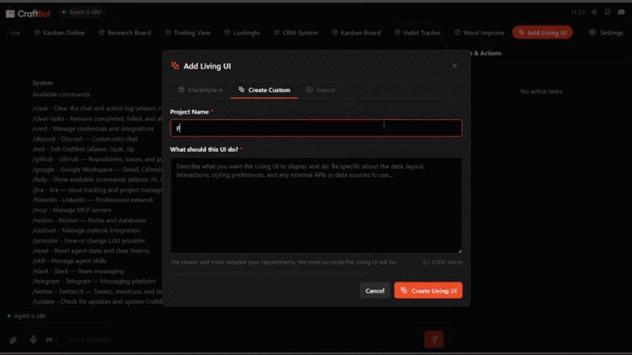

<div align="center">
    
</div>

大多數 Agent 框架止步於對話和工具呼叫,CraftBot 走得更遠。它會自己建立、演進並運行 SaaS 工具,然後透過這套工具層與你溝通,並替你完成自動化工作。

除此之外,CraftBot 擁有通用 Agent 框架的全部核心能力。它像一位遠端員工一樣執行任務、記住你的偏好與目標,並主動協助你規劃並推進對你來說重要的事情。

<p align="center">
  
  
  


  <a href="https://github.com/CraftOS-dev/CraftBot">
    
  </a>

  

  <a href="https://discord.gg/ZN9YHc37HG">
    
  </a>

  <a href="https://deepwiki.com/CraftOS-dev/CraftBot">
    
  </a>
</p>

<div align="center">
	
[](https://e2b.dev/startups)
</div>

<p align="center">
  <a href="README.md">English</a> | <a href="README.ja.md">日本語</a> | <a href="README.cn.md">简体中文</a> | <a href="README.ko.md">한국어</a> | <a href="README.es.md">Español</a> | <a href="README.pt-BR.md">Português</a> | <a href="README.fr.md">Français</a> | <a href="README.de.md">Deutsch</a>
</p>

## ✨ 核心特色

除了能夠建立並運行自有的 SaaS 工具,CraftBot 還具備 Agent 框架的全部核心能力,可以作為通用 AI Agent 陪你處理任務、工具、記憶與日常工作流程。

- **Agent 設定檔** 40+ Agent 設定檔(CEO Agent、財務 Agent、行銷負責人 Agent、DevOps 工程師、影片製作人 Agent 等共 37 種)隨時準備為你工作。從 **[CraftBot Agent Bundles](https://github.com/CraftOS-dev/craftbot-agent-bundles)** 找到想要的角色,一鍵匯入。
- **Playbook 目錄** 不知道如何用 AI Agent 自動化?CraftBot 內建 120 個 Playbook(涵蓋 19 個分類)隨時可用。從頂部列開啟 Playbook 選擇器,挑一個 Playbook,它就會開始替你執行任務。
- **Agent App.** 在 CraftBot 內建立、匯入或演進自訂應用程式。Agent 隨時掌握 UI 的狀態,並能直接讀取、寫入並操作其中的資料。
- **多工與工作階段路由.** 還在手動輸入 `/new` 指令嗎?CraftBot 能自己判斷何時該開啟新會話、何時要繼續舊任務,讓對話與上下文保持一致。
- **自架與 BYOK.** 彈性的 LLM 供應商系統,支援 OpenAI、Google Gemini、Anthropic Claude、OpenRouter 等。也可以用 Ollama 自架模型,完全不耗 Token。
- **記憶系統.** 從你與 CraftBot 的互動中建立的第二大腦。混合方案:RAG + 知識圖譜 + Agent 檔案系統。CraftBot 會在午夜「做夢」,整合一整天發生的事件。
- **主動型 Agent.** 學習你的偏好、習慣與人生目標,然後主動規劃並發起任務(當然會徵求你的同意),協助你在生活中變得更好。
- **外部工具整合.** 連接你的應用,例如 Google Workspace、Slack、Notion、Zoom、LinkedIn、Discord、Telegram 等(更多正在路上),支援 OAuth 或使用你自己的金鑰。每個整合都可以連接多個帳號。
- **Skills 與 MCP.** 已備好 150+ MCP 與 170+ Skills,支援快速安裝新的 Skills 與 MCP,也能從已完成的任務一鍵建立或改進 Skills。
- **瀏覽器或終端機.** 選擇最適合你的方式使用 CraftBot:日常使用走簡潔的瀏覽器 UI,也可以使用完整的終端機版(`python run.py --tui`),聊天、設定和 Agent App 都一樣。

---


## 🧰 快速開始

**環境需求**

- Windows 10 或 11(x64)、macOS 12 或更新版本(Apple Silicon 或 Intel),或 Linux(x86_64 或 ARM64)
- 至少 5 GB 可用磁碟空間
- 一組 LLM 服務商的 API 金鑰(例如 OpenAI、Anthropic、Google Gemini 或 OpenRouter),或透過 Ollama 執行的本機模型
- 僅原始碼安裝需要:Python 3.8 或更新版本。不需要安裝 Node.js。

### 方式一:安裝程式(建議,不需要 Python 或 Git)

從[最新發布頁面](https://github.com/CraftOS-dev/CraftBot/releases/latest)下載適合你系統的檔案:

| 系統 | 檔案 |
|---|---|
| Windows(x64) | `CraftBotInstaller-windows.exe` |
| macOS(Apple Silicon 與 Intel) | `CraftBotInstaller-macos.zip` |
| Linux(x86_64) | `CraftBotInstaller-linux-x86_64` |
| Linux(ARM64) | `CraftBotInstaller-linux-aarch64` |

開啟後點選 **Install CraftBot**。安裝程式會下載 CraftBot 需要的所有內容,啟動 CraftBot,並在瀏覽器中開啟。

安裝程式目前尚未進行程式碼簽署,因此第一次啟動需要多一個步驟:

- **Windows:** 如果 SmartScreen 顯示「Windows 已保護您的電腦」,點選 **其他資訊**(More info),再點選 **仍要執行**(Run anyway)。
- **macOS:** 解壓縮後開啟 `CraftBotInstaller.app`。在 macOS 15 或更新版本上,第一次開啟會被阻擋:開啟 **系統設定 > 隱私權與安全性**,在關於 CraftBotInstaller 的訊息旁點選 **強制打開**(Open Anyway)並確認。在 macOS 12 至 14 上,請在 App 上按右鍵並選擇 **打開**(Open)。
- **Linux:** 為檔案加上執行權限,然後在桌面工作階段中執行(沒有桌面環境的伺服器請使用原始碼安裝):
  ```bash
  chmod +x CraftBotInstaller-linux-x86_64
  ./CraftBotInstaller-linux-x86_64
  ```

### 方式二:從原始碼安裝

電腦上已有的任何 Python 3.8 或更新版本都可以。CraftBot 會下載自己專用的 Python 3.10 與 Node.js 24,不會更動系統中已安裝的 Python 或 Node.js。

```bash
git clone --depth 1 https://github.com/CraftOS-dev/CraftBot.git
cd CraftBot
```

接著執行對應系統的安裝指令:

```bash
# Windows
python craftbot.py install        # 或:py craftbot.py install

# macOS 與 Linux
python3 craftbot.py install
```

- **沒有 Git?** 在[儲存庫頁面](https://github.com/CraftOS-dev/CraftBot)點選 **Code > Download ZIP**,解壓縮後在該資料夾開啟終端機,執行相同的指令。
- **沒有 Python,或版本低於 3.8?** 請使用安裝程式(方式一)。

第一次安裝約需下載 1 GB,在一般網路環境下需要幾分鐘。完成後,CraftBot 會在背景執行,在瀏覽器開啟 http://localhost:7925,並建立桌面捷徑。如果 7925 或 7926 連接埠已被占用,CraftBot 會改用下一個可用的連接埠,並顯示要開啟的網址。

第一次啟動時,瀏覽器中的引導流程會請你輸入 LLM API 金鑰。CraftBot 會將金鑰儲存在 `app/config/settings.json`(之後可在設定中修改),不會從 `.env` 檔案讀取 API 金鑰。

### 管理 CraftBot

使用與安裝時相同的 `python` 或 `python3` 指令:

```bash
python craftbot.py start      # 在背景啟動 CraftBot
python craftbot.py stop       # 停止 CraftBot
python craftbot.py restart    # 重新啟動 CraftBot
python craftbot.py status     # 查看執行狀態以及是否已啟用自動啟動
python craftbot.py logs       # 顯示最近 50 行記錄(更多:logs -n 200)
python craftbot.py uninstall  # 停止執行、移除自動啟動並解除安裝套件
python run.py --tui           # 在終端機中執行,而不是在瀏覽器中
```

使用安裝程式的使用者可以在安裝程式視窗中完成相同的操作(**Start**、**Stop**、**Repair**、**Uninstall**)。

> [!TIP]
> 執行 `install` 或 `start` 之後,系統會自動建立 **CraftBot 桌面捷徑**。如果關閉了瀏覽器,雙擊捷徑即可重新開啟。

---

## 🌱 Agent App

**Agent App 是會隨著你的需求一起演進的系統/應用/儀表板。**

<div align="center">
    
</div>

- 想要一塊內建 AI 協作夥伴的 Kanban 看板?
- 一套完全貼合你工作流程的客製化 CRM?
- 一個 CraftBot 可以代替你讀取並操作的公司儀表板?

將它作為 Agent App 啟動:它會與 CraftBot 並行運作,並隨著你的需求變化而成長。

### 建立 Agent App 的三種方式

1. **從零開始建立.** 用自然語言描述你想要的東西,CraftBot
   會幫你搭好資料模型、後端 API 與 React 前端,
   並透過一套結構化的設計流程與你不斷迭代。

<div align="center">
    
</div>

2. **從市集安裝.** 在 [living-ui-marketplace](https://github.com/CraftOS-dev/living-ui-marketplace) 瀏覽社群打造的 Agent App。

<div align="center">
    
</div>

3. **匯入既有專案.** 把 Go、Node.js、Python、Rust,
   或是靜態原始碼或 GitHub 儲存庫交給 CraftBot,它會自動偵測執行環境、設定健康檢查,並包裝成一個 Agent App。

<div align="center">
    
</div>

### 讓 CraftBot 始終參與其中,持續演進

Agent App 永遠沒有「完成」這回事。需求一變,
就讓 Agent 為它加上新功能、重新設計頁面或接上新的資料源。

CraftBot 嵌入在每一個 Agent App 中,並且**對其狀態保持感知**:
它可以讀取目前的 DOM 與表單值、透過 REST API 查詢應用資料,
並代你觸發操作。

### 讓 SaaS 工具保持開放且不停演進

打造、自訂並不斷演進屬於你自己的 Agent App,降低對那些根本沒為你量身打造的訂閱工具的依賴。

---
 
# 三個 5 分鐘內就能試玩的 Agent App
 
- **📋 Kanban 看板**:把任務、後續追蹤與待辦集中到一個地方,CraftBot 可以接手操作,替你完成 PM 工作。
- **📊 習慣追蹤器**:培養並追蹤自己的習慣,用類 GitHub 風格的活動日曆像寫程式一樣維護你的習慣。
- **🐦 Luolinglo**:不是 Duolingo,但你可以學新語言、做單字卡片,並和 CraftBot 一起練習。

**[瀏覽 Agent App 市集並貢獻你的作品 →](https://craftos.net/marketplace)**

---

## 🔧 疑難排解與常見問題

**先查看記錄。** `python craftbot.py logs` 會顯示最近 50 行記錄(更多:`logs -n 200`)。`install` 或 `start` 失敗時,會顯示記錄的最後幾行並以錯誤狀態結束。`python craftbot.py doctor` 會逐一檢查每個安裝步驟,不做任何變更。在安裝程式中可點選 **Open log**。

**重新執行安裝是安全的。** `python craftbot.py install` 會略過已經成功的步驟,只重試其餘步驟。在安裝程式中可點選 **Repair**。

### 7925 或 7926 連接埠已被占用

CraftBot 會改用下一個可用的連接埠,並顯示要開啟的網址。若要自行指定連接埠:

```bash
python craftbot.py start --frontend-port 8925 --backend-port 8926
```

### Proxy 或公司網路

所有下載(Python、pip、npm、Node.js)都會使用標準的 Proxy 環境變數。請在安裝前於同一個終端機中設定:

```bash
# macOS 與 Linux
export HTTPS_PROXY=http://proxy.example.com:8080
export HTTP_PROXY=http://proxy.example.com:8080
export NO_PROXY=localhost,127.0.0.1
python3 craftbot.py install
```

```powershell
# Windows PowerShell
$env:HTTPS_PROXY = "http://proxy.example.com:8080"
$env:HTTP_PROXY = "http://proxy.example.com:8080"
$env:NO_PROXY = "localhost,127.0.0.1"
python craftbot.py install
```

會檢查 TLS 流量的網路不需要額外設定:CraftBot 會信任作業系統憑證存放區中的憑證。

### 下載緩慢或無法連線(例如在中國大陸)

安裝前將下載來源指向鏡像站:

| 變數 | 用途 | 範例 |
|---|---|---|
| `PIP_INDEX_URL` | Python 套件 | `https://pypi.tuna.tsinghua.edu.cn/simple` |
| `npm_config_registry` | npm 套件 | `https://registry.npmmirror.com` |
| `HF_ENDPOINT` | 嵌入模型 | `https://hf-mirror.com` |
| `CRAFTBOT_MIRRORS` | Python、Node.js、PocketBase 與嵌入模型的下載 | 見下方 |

`CRAFTBOT_MIRRORS` 是以分號分隔的 `prefix=replacement`(前綴=替換網址)URL 改寫規則:

```bash
export CRAFTBOT_MIRRORS="https://github.com/=https://<your-github-proxy>/https://github.com/;https://nodejs.org/dist/=https://npmmirror.com/mirrors/node/"
```

Python 套件和記憶嵌入模型仍會以固定的 SHA-256 檢查碼驗證,因此鏡像站無法改變它們。Python 和 Node.js 執行環境沒有固定檢查碼,請只為它們使用你信任的鏡像站。在 Windows PowerShell 中,請用 `$env:NAME = "value"` 取代 `export` 來設定變數。

### 沒有桌面環境的伺服器

在伺服器上從原始碼安裝,且不開啟瀏覽器:

```bash
python3 craftbot.py install --no-open-browser
```

CraftBot 只監聽 `localhost`,並且只接受以 `localhost` 連線的瀏覽器。若要從自己的電腦使用,請建立以相同連接埠號碼轉送兩個連接埠的 SSH 通道,然後在自己的電腦上開啟 http://localhost:7925:

```bash
ssh -L 7925:localhost:7925 -L 7926:localhost:7926 user@server
```

`CRAFTBOT_BIND_HOST` 可讓 CraftBot 監聽其他網路介面(Docker 映像檔使用 `0.0.0.0`)。遠端存取仍應透過 SSH 通道進行。

### Linux:重新開機後 CraftBot 沒有自動啟動

自動啟動是一個 systemd 使用者服務,因此需要 systemd 使用者工作階段。若要在開機時不需登入即可啟動 CraftBot,並在登出後繼續執行,請執行一次:

```bash
loginctl enable-linger $USER
```

在沒有 systemd 的環境中(例如未啟用 systemd 的 WSL),請在每次開機後執行 `python3 craftbot.py start`。

### macOS:安裝程式被阻擋

安裝程式尚未進行程式碼簽署。在 macOS 15 或更新版本上,先嘗試開啟一次,然後開啟 **系統設定 > 隱私權與安全性** 並點選 **強制打開**(Open Anyway)。在 macOS 12 至 14 上,請在 App 上按右鍵並選擇 **打開**(Open)。

### Windows:SmartScreen 阻擋安裝程式

點選 **其他資訊**(More info),再點選 **仍要執行**(Run anyway)。出現這個警告是因為安裝程式尚未進行程式碼簽署。

### Windows:輸入 `python` 卻開啟了 Microsoft Store

表示系統中沒有安裝 Python。請使用安裝程式,或從 [python.org](https://www.python.org/downloads/) 安裝 Python 後執行 `py craftbot.py install`。

### 將 CraftBot 的資料存放在其他位置

安裝前將 `CRAFTBOT_HOME` 設為某個資料夾(例如容量較大的磁碟上的資料夾),CraftBot 的所有資料與下載的執行環境都會存放在那裡。自動啟動會保留這項設定。

### 瀏覽器功能(Playwright)

Mini Browser 與瀏覽器自動化使用 Playwright 的 Chromium。即使它下載失敗,CraftBot 的其他功能仍可正常使用。之後重新執行 `python craftbot.py install` 即可重試。

---

## 🐳 使用容器執行

Docker 映像檔以瀏覽器模式執行 CraftBot,所需元件皆已預先安裝:Python 3.10 及其鎖定的相依套件、Node.js 24、瀏覽器介面、PocketBase 與 Playwright 的 Chromium。

在儲存庫根目錄執行:

```bash
docker compose up -d
```

第一次建置需要幾分鐘。完成後開啟 http://localhost:7925,並在引導流程中輸入你的 LLM API 金鑰。

設定與 API 金鑰、Agent 檔案、記憶與記錄都保存在 `craftbot-data` 磁碟區中,重新啟動容器或重新建置映像檔後依然保留。

```bash
docker compose logs -f craftbot              # 即時查看記錄
docker compose ps                            # 查看狀態(含健康檢查)
docker compose down                          # 停止(資料磁碟區會保留)
git pull && docker compose up -d --build     # 更新到最新版本
```

- 連接埠只發布在 `127.0.0.1` 上,因為 CraftBot 介面本身沒有登入機制。在遠端伺服器上請維持這個設定,並透過「疑難排解」中說明的 SSH 通道連線。主機連接埠請維持 7925 與 7926:CraftBot 只接受以 `localhost` 連線到這兩個連接埠的瀏覽器。
- 在 shell 或 `docker-compose.yml` 同一資料夾的 `.env` 檔案中設定的 Proxy 與鏡像變數(`HTTPS_PROXY`、`PIP_INDEX_URL`、`HF_ENDPOINT`、`CRAFTBOT_MIRRORS`,以及 `.env.example` 中列出的其他變數)會傳入容器。
- Agent App 在容器內的 3100 至 3199 連接埠執行,目前還無法從主機的瀏覽器開啟。若要使用 Agent App,請使用安裝程式或原始碼安裝。
- 不使用 Compose 時:
  ```bash
  docker build -t craftbot .
  docker run -d --name craftbot -p 127.0.0.1:7925:7925 -p 127.0.0.1:7926:7926 --shm-size 1g -v craftbot-data:/data craftbot
  ```

---

## 🤝 如何貢獻

歡迎送 PR!工作流程(fork → 從 `dev` 切分支 → 送 PR)詳見 [CONTRIBUTING.md](CONTRIBUTING.md)。所有 PR 都會自動跑 lint + 冒煙測試 CI。

> [!IMPORTANT]
> **CraftBot** 正在積極開發中,每週都有改進。有問題或想更快交流,歡迎加入 [Discord](https://discord.gg/ZN9YHc37HG),或寄信至 thamyikfoong(at)craftos.net。

---

## 🧾 授權

本專案以 [MIT 授權](LICENSE) 開放原始碼。你可以自由地使用、自架以及商業化本專案(進行散布或商業化時,需保留對本專案的署名)。

---

## ⭐ 致謝

由 [CraftOS](https://craftos.net/) 與貢獻者共同開發與維護。  
如果你覺得 **CraftBot** 有用,歡迎給儲存庫一顆 ⭐ 並分享給更多人!

---

## Star 歷史

<a href="https://star-history.dera.page/#CraftOS-dev/CraftBot&type=date&legend=top-left">
 <picture>
   <source media="(prefers-color-scheme: dark)" srcset="https://star-history.dera.page/svg?repos=CraftOS-dev/CraftBot&type=date&theme=dark&legend=top-left" />
   <source media="(prefers-color-scheme: light)" srcset="https://star-history.dera.page/svg?repos=CraftOS-dev/CraftBot&type=date&legend=top-left" />
   
 </picture>
</a>
