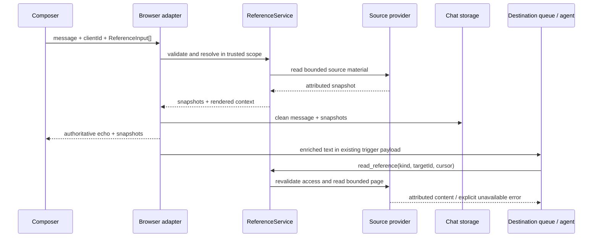

# Reference system: research and implementation proposal

Date: 26 October 2026. Status: research proposal followed by implementation on the branch below. See [implementation notes](../../app/references/README.md) for the delivered behavior, extension contract, checks, and limitations. The remaining sections preserve the original design analysis.
Original research baseline: `94aa652fdc89c6bab653e157ce7eba3e8dad5d14` (`V1.4.5`).
Working branch: `feature/reference-system`.

## Recommendation

Add **Reference…** to the chat composer's **+** menu and an **@ autocomplete** in the chat box that opens a searchable list and filters immediately as the user types. Both entry points use the same reference catalog, filtering, selection, and pending-reference state. Start with **Sessions** and **Agent apps**. Send references as structured message metadata, resolve them on the server, and include a bounded, attributed snapshot in the receiving session's user-message context. Supply one read-only action to retrieve additional source material.

Use a small `ReferenceService` composed with two providers. Keep identity, discovery, content resolution, UI rendering, and actions separate. Reuse session/app managers and chat storage; do not introduce another source-of-truth database for sessions or apps. Preserve existing file upload behavior. Later file, folder, URL, or integration providers should implement the same small contract when actually required.

The central distinction: a reference identifies context. It does not resume another session, send it a message, run an app, grant extra tools, or authorize app mutations.

## What CraftBot already does

Paths below are relative to the repository root; function names are more durable anchors than line numbers.

| Area | Evidence in this checkout | Consequence |
| --- | --- | --- |
| Composer | `app/ui_layer/browser/frontend/src/components/Chat/Chat.tsx`, `handleSend`, `processFiles`, plus-menu markup | The observed menu contains Attach files and AI Enhance. File inputs, paste, and drop feed pending attachments. I did not find a dedicated folder reference item in this composer; do not assume upload equals folder context. |
| Client transport | `frontend/src/contexts/WebSocketContext.tsx`, `sendMessage` (under the browser directory above) | Serializes content, attachments, explicit sessionId, replyContext, clientId; creates an optimistic bubble and handles draft sessions. References must survive all these steps. |
| Reconnect | `frontend/src/store/socket/SocketClient.ts` | Queues outbound envelopes with an expiry. Add references to the existing envelope rather than a second sending channel. |
| Submission | `app/ui_layer/adapters/browser_adapter.py`, `_handle_ws_message`, `submit_message`, `_handle_chat_message_with_attachments` | Text and attachments take different paths. Attachment processing saves bytes, displays a clean bubble, and forwards file descriptors as agent text. Avoid adding a third duplicated submission implementation. |
| Controller | `app/ui_layer/controller/ui_controller.py`, `submit_message` | Already distinguishes displayed text from `agent_text`, but rejects an empty displayed message and executes commands first. A reference-only message and slash text with references need explicit handling. |
| Session model | `agent_core/core/session/session.py`, `Session`, `SessionType` | A persistent independent lane with its own queue, stream, skills, and budgets. Types are main, chat, agent_app. Referencing must not merge these states. |
| Session lifecycle | `app/session/session_manager.py` | Wraps shared SessionManager; persists streams; seeds agent-owned NOTE.md. Deletion clears chat and activity storage. NOTE.md is a scratchpad, not a guaranteed authoritative summary. |
| Session list | `browser_adapter.py`, `_handle_session_list`, `_session_info`; `frontend/src/store/selectors/sessions.ts` | Discovery metadata already exists. `selectChatSessions` excludes main and agent_app; that sidebar selector alone is insufficient for a complete reference picker. |
| Visible transcript | `app/usage/chat_storage.py`, `StoredChatMessage`, `get_recent_messages`, `get_messages` | SQLite storage is session scoped. `get_messages` starts at the oldest row; `get_recent_messages` returns a recent tail chronologically. Never accidentally use an unscoped call where None means all sessions. |
| Message round trip | `app/ui_layer/components/types.py`, `ChatMessage.to_dict`; `browser_adapter.py`, `_stored_to_chat_message`, chat append persistence | A new field must pass through Python model, SQLite, serializers, broadcast, TS model, optimistic state, and history reload. Updating only TS drops references on reload. |
| Agent ingestion | `app/agent_base.py`, `_handle_chat_message` | Enriched content travels through the durable trigger payload; the event is written when its trigger is claimed. Preserve this ordering for messages arriving mid-run. Do not write references directly into another stream. |
| App identity | `app/agent_app/manager.py`, `AgentAppProject`, `get_project`, `list_projects`, `get_project_by_session_id` | Apps have stable project IDs and dedicated session IDs; ports and runtime URLs are mutable. Project identity and its conversation are distinct reference types. |
| App context | `app/agent_app/agent_view.py`; `app/agent_base.py`, `_build_agent_app_note` | Existing schema/operation/capability renderers use A2APP describe. Their comments document models ignoring advisory file pointers. Reuse bounded descriptive data carefully; the owning-app prompt also supplies interaction context and is too broad to reuse blindly. |
| Shared core | `app/context_engine.py` | Re-exports the shared context engine. Keep CraftBot-specific providers in app/, rather than putting UI/app dependencies into agent_core. |

This is static code inspection, not an end-to-end runtime validation. Existing comments referencing a missing `docs/plans/attachment-reception-plan.md` were not treated as an available design specification.

## External research and what to adopt

Research used primary documentation. Product documentation changes; these are design observations as accessed on the date above, not compatibility guarantees.

| System / source | Observed pattern | Application to CraftBot |
| --- | --- | --- |
| [Cursor Learn: Working with agents](https://prod.cursor.com/learn/working-with-agents) | Discusses referencing an older conversation so an agent can read its transcript. | Make cross-session continuity explicit and navigable. |
| [Cursor Agent overview](https://prod.cursor.com/docs/agent/overview) | Describes durable side chats with their own transcripts, and mentioning a side chat to bring context back. | Preserve independent session identity while sharing selected information. |
| [Continue context providers](https://docs.continue.dev/customize/deep-dives/custom-providers) | Context menu supports different sources; recommends MCP for context beyond built-ins. | A source adapter is a useful seam. Avoid reproducing a large legacy provider/plugin ecosystem. |
| [Continue context selection](https://docs.continue.dev/ide-extensions/agent/context-selection) | Manual context and tool responses both supply model context. | Initial references and later reads can share one content representation. |
| [Claude Code subagents](https://code.claude.com/docs/en/sub-agents) | Non-fork subagents start with isolated context; resume and fork have distinct semantics. | Reading another conversation must remain distinct from resuming or delegating to it. |
| [Cline tasks](https://docs.cline.bot/core-workflows/task-management) | Tasks are self-contained and searchable; long context is compressed. | Offer title-based discovery initially, preserve source links, and disclose incomplete excerpts. Full-text indexing can wait. |
| [Aider repository map](https://aider.chat/docs/repomap.html) | Uses a compact structural representation selected within a token budget. | Put useful bounded context upfront, then expand on demand. Do not copy its repository graph-ranking machinery for two local reference types. |
| [MCP resources, version 2025-06-18](https://modelcontextprotocol.io/specification/2025-06-18/server/resources) | Separates resource identity/metadata, listing, and reading; supports pagination and optional subscriptions. | Adopt identity/descriptor/read separation. Treat subscriptions as optional future complexity. This is a versioned design source, not a claim about the latest protocol version. |

Search also surfaced older Cursor @Past Chats pages and conflicting historical behavior. Prefer the current primary pages above; do not base our contract on a particular historic @ command. No benchmark proves one product's strategy best for CraftBot; the recommendation combines these patterns with the concrete code constraints above.

## Alternatives

| Approach | Benefits | Cost / problem | Decision |
| --- | --- | --- | --- |
| Paste session/app details into prompt text | Very quick | Loses identity, navigation, refresh semantics, and structured persistence | Reject as the reference representation; still render text for the LLM. |
| Extend Attachment with optional sessionId/appId | Reuses chips | Files require bytes/path/MIME; sessions do not. Creates invalid combinations and couples uploading to discovery | Keep Attachment separate. Share presentation only where useful. |
| Switch on kind throughout composer, adapter, storage, prompts | Small initial diff | Every source addition touches unrelated layers | Central provider mapping and generic UI. Small explicit source-specific navigation mapping is acceptable. |
| Full resource graph / dynamic plugin framework / RAG index | Broad capabilities | No demonstrated need; increases migration, lifecycle, permission, and retrieval complexity | Defer. |
| Descriptor-only pointers | Very small prompt | CraftBot's app-context evidence shows models may ignore instructions to read details | Include a useful excerpt and a read action. |
| Entire transcript/app directory every turn | Maximum initial recall | Token growth, stale content, private data, recursive references | Reject. |
| Small provider service + snapshots + bounded reads | Clear responsibilities, extensible, measurable | Requires end-to-end metadata plumbing | Recommended. |

## Semantics and UX

1. **+ → Reference…** opens a dialog with Sessions / Agent apps filters, search, recent ordering, multi-select, and visible selected state. Reuse existing list state for initial discovery; server resolution is authoritative. Show main explicitly, ordinary chats, and apps once each. Hide the current destination session; show an app's build conversation only as an explicitly chosen session, not a duplicate app result.
2. Display removable chips beside attachments, with an icon, type, and title. Identity is `(kind, targetId)`, so renames do not break deduplication. Repeated selection focuses the existing chip. Session switches reset pending references in the same way the composer scopes other pending state; do not accidentally move selections across sessions.
3. Sent chips open a preview of the **captured** content and offer Open source. Previewing does not silently refresh content. If a source has disappeared, show Unavailable while retaining the original captured excerpt under the retention rule below.
4. Support text + reference, attachment + reference, and reference-only messages. A reference-only message uses a server-generated display sentence such as “Referenced: Pricing discussion” so existing nonempty-text assumptions are handled deliberately. Include reference labels in pinned-question answer fallbacks.
5. Slash-command routing applies only when there are no attachments or references. Keep this predicate consistent in Chat.tsx, WebSocketContext, and backend submission; currently client code has different slash checks. Plain text beginning with `/` plus references is a normal chat message.
6. Excerpts are snapshots at server acceptance, not a live subscription. Picking a source is not a snapshot boundary. Later source edits do not rewrite historical prompts; reattaching captures a fresh version. Additional reads are explicitly marked live reads with a new capture time.
7. References apply to the submitted message and its normal conversation history. Do not silently pin/reinject them into every future turn. Existing compaction may summarize that history.
8. Search starts with case-insensitive title/name/description filtering over available metadata. Both the + dialog and @ autocomplete update results on every query change. No full-transcript search or separate network search API in v1. Keyboard navigation, Escape, focus restoration, accessible dialog/chip labels, loading/empty/error states, and localized strings are required.

### @ autocomplete in the chat box

Typing `@` at the start of the input or after whitespace opens a compact list above the composer, initially showing recent sessions and apps with type labels. Typing `@pricing` immediately filters that list. Match case-insensitively across title/name/description, using the same pure search function as the + dialog. Apply deterministic ordering (exact name, prefix, substring, then recency with stable ID tie-breaks). Results include both kinds; future registered sources automatically participate through the shared catalog.

Track the active trigger range using the textarea's `selectionStart`/`selectionEnd`, not a regex over the entire input. Only activate for a collapsed selection and a valid trigger preceding the caret. Do not open inside ordinary email addresses such as `name@example.com`. Recompute on text edits and caret changes; moving outside the active range, a newline, or Escape closes the popup. Allow spaces within the query for multiword titles. Escape suppresses reopening for that trigger until it is edited or a new trigger starts; leaving a dismissed query as text does not attach anything.

Selecting by click, Enter, or Tab adds the item's `(kind, targetId)` to the same pending references used by +, removes only the active `@query` range, preserves surrounding text, and restores the caret at that position. The visible result is the existing removable reference chip beside attachments. Selecting an already attached source consumes the query and focuses its existing chip. This intentionally keeps the current textarea: inline editable mention tokens and position mappings are unnecessary for the initial requirement. Literal `@text` that is never selected remains ordinary message text; the backend never infers references from it.

Arrow Up/Down navigate results. Enter commits a highlighted result without sending the message; a second Enter after selection follows normal send behavior. While the popup is open with no matches, Enter must not accidentally send: show No matches and let Escape dismiss it. Tab commits a highlighted result; with no results it retains normal focus navigation and closes the popup. Shift+Enter retains newline behavior and closes the popup. Ignore autocomplete navigation/selection during IME composition. Prevent pointer selection from blurring the textarea before its trigger range is applied. Use listbox/option semantics, `aria-expanded`, `aria-controls`, and `aria-activedescendant` on the textarea; retain focus in the input while navigating suggestions.

CraftBot already has `components/ui/SlashCommandAutocomplete.tsx`, with imperative keyboard handlers invoked by Chat.tsx. Add a separate ReferenceAutocomplete with a similarly small interface, sharing reference search/selection logic with the dialog. Let the active @ popup handle keys before slash autocomplete, input history, or send; only one popup owns a key event. Do not generalize both systems into an autocomplete framework unless shared behavior actually warrants extraction. Because local metadata filtering is cheap, update synchronously without a debounce. If remote search is added later, debounce only network requests, cancel obsolete requests, and ignore late responses while preserving input responsiveness and highlighted identity.

## Minimal contracts and composition

Illustrative shapes, not implemented APIs:

```typescript
type ReferenceKind = 'session' | 'agent_app'
type ReferenceInput = { kind: ReferenceKind; targetId: string }
type ReferenceSnapshot = ReferenceInput & {
  schemaVersion: 1
  label: string
  capturedAt: string
  contentHash: string
  excerpt: string
  truncated: boolean
}
// Optional message.references: ReferenceSnapshot[] on server echoes/history.
// Client sends ReferenceInput[] only; it cannot supply authoritative content.
```

Use a finite TS union for supported sources and reject unknown input kinds on the backend. “Extensible” does not require arbitrary strings accepted from clients. Adding a new source deliberately extends the supported kinds and registers its provider.

Python can use frozen dataclasses and a structural `Protocol`:

```python
class ReferenceProvider(Protocol):
    kind: str

    async def resolve(self, target_id: str, context: ReferenceContext,
                      budget: ReferenceBudget) -> ReferenceSnapshot: ...

    async def read(self, target_id: str, context: ReferenceContext,
                   cursor: str | None, budget: ReferenceBudget) -> ReferencePage: ...
```

`ReferenceService` receives a plain `{kind: provider}` mapping at composition time. It validates requests, deduplicates, applies count/total budgets, dispatches resolution, and renders attributed model context. Providers own source access, validation, and extraction. Inject session manager/chat storage into SessionReferenceProvider and app manager into AgentAppReferenceProvider. They should not construct global managers or import browser_adapter.

`ReferenceContext` carries trusted destination session and access scope, not caller-supplied claims. Local mode can use its current authenticated application scope; do not invent a user/tenant model without one. Validate that source and destination exist and are accessible on resolve and every subsequent read. If access filtering is absent in existing managers, keep that limitation explicit and centralize the predicate for future deployment modes.

Discovery need not be part of this initial Python protocol because existing WS lists already serve it. If a future remote source needs server-side search, add a small discovery capability then. Do not require every source to implement upload, subscribe, execute, preview HTML, or writes.

Model representation uses stable `(kind, targetId)` fields, plus captured title and timestamp. A canonical URI can later be derived for an MCP adapter; do not store both a URI and an independent ID that can disagree. Runtime app URLs, absolute client paths, and display labels are not identity or authority.

## Content policy

### Sessions

Capture title/type and a recent chronological window of visible user/agent messages from ChatStorage. Preserve message IDs, speakers, and timestamps in the excerpt so claims can be attributed. Use a deterministic total order `(timestamp, message_id)` for new pagination, including equal timestamps. Exclude internal reasoning/activity, raw action results, hidden event-stream content, base64 attachments, executable UI HTML, and recursively embedded reference excerpts. Visible messages may contain sensitive information; only explicitly selected accessible sources are eligible.

Start with a recent tail and clearly state omitted earlier messages. `get_recent_messages` can seed the first slice, but the existing API does not supply a bounded stable pagination contract for the new action; add a focused query using a high-water mark and cursor, without rewriting general chat history APIs. Read pages fix their high-water mark so new messages do not cause duplicates/skips. Detect source clear/delete and reject stale cursors. Do not treat NOTE.md as an authoritative summary or generate an LLM summary during send. A later summary index needs its own quality/retention proposal.

### Agent apps

Capture project ID/name/description/features/type/status and a bounded descriptive schema/operation overview if available. Use an explicit allowlist; do not serialize the entire project object or app directory. Never expose bridge/superuser tokens, `.superuser`, environment secrets, `.env`, customer records, databases, logs, or arbitrary project files. Do not include build-session transcript automatically: the user can select that session separately.

Reuse describe/rendering logic from agent_view where its output is suitable, but avoid blocking synchronous HTTP work on the event loop. Use a worker thread or async adapter with a timeout and enforce response byte limits before decoding. Validate the manager-derived origin instead of fetching a client-provided URL. A stopped app yields useful project metadata plus “schema unavailable”; it is never launched to resolve a reference. Readable operation descriptions do not grant operation execution. Existing action sets and app consent still apply.

### Budgets and trust

Proposed starting limits, to tune with actual model context sizes: 8 unique references; 8 KiB UTF-8 per initial excerpt; 32 KiB total excerpts per message; 24 KiB per read result; 2-second optional app describe timeout. Bound raw reads before parsing and cap metadata too. Byte limits provide hard resource bounds but are not token estimates; additionally fit rendered content into the actual active model's remaining input budget using the existing tokenizer/context facilities where available. Reduce excerpts deterministically and show omission markers; never split invalid UTF-8. If budget is too small for meaningful context, return a useful explicit error.

Reference content is untrusted source material even when it came from an earlier agent response. Render it as attributed data, separate from the user's instruction and system prompt; escape delimiters and cap fields. Prompt framing helps but does not enforce permissions. Server-side checks and existing tool authorization enforce access. Do not recurse through references in the source, and do not change source state while reading.

## End-to-end integration



Resolve before accepting the message, then use the same snapshots for storage, echo, and trigger text. Resolution must not be repeated when the queued turn starts after a delay. Preserve the existing deferred stream write.

Keep one metadata-aware submission helper for normal text, attachments, and references. Existing attachment normalization can remain a separate helper; migrate its result into the common path without rewriting upload infrastructure. Carry displayed text, enriched agent text, normalized attachments/references, destination, reply context, and clientId as explicit parameters or one small submission dataclass. Do not embed UI persistence into providers.

Thread optional `references` through ChatMessage, StoredChatMessage, `_ROW_COLUMNS`, insertion/row conversion, serializers, stored-message conversion, UI event payloads, broadcast, history loaders, TS types, and optimistic reconciliation. Add an additive nullable JSON column using ChatStorage's existing migration style. Old rows mean no references. Preserve unknown stored kinds as inert “unsupported reference” chips with captured labels; never resolve them through a guessed provider.

The read action `read_reference(kind, target_id, cursor?)` resolves only identities attached to messages in the destination session, checks current source access, and returns bounded typed content. Query membership server-side from persisted references, not the model's asserted scope. Avoid adding permanent session-level pin state. Include this single read action in the existing always-available core action registration, following `@action` conventions; confirm both CLI/GUI exposure so users do not receive references they cannot expand. It must not execute apps or message sessions.

### Failure and lifecycle rules

- Unknown kind, malformed ID, inaccessible/missing selected source, or excessive count: reject before normal message acceptance. Return a correlated structured error so the optimistic bubble stops spinning and the composer can restore editable content/references. Optional app schema failure is a degraded snapshot, not a missing source.
- A source deleted/cleared after acceptance cannot change the accepted snapshot. Later live reads fail explicitly. A rename changes the source display on navigation; the captured label remains historical.
- Snapshot excerpts are copies in the destination history, much like quoted text. Deleting the source alone does not purge those copies. Make this behavior explicit in UX/help. Deleting/clearing the destination removes its stored copies through normal history cleanup. If product requires source-wide erasure, a reverse-reference index and purge policy must be designed before shipping that promise.
- Use existing clientId reconciliation, and audit duplicate acceptance across history storage and trigger enqueue. Exactly-once delivery is not established by an optimistic UI UUID. If reconnect replay can duplicate a submission, persist a destination/clientId acceptance record (with captured snapshot) and reuse it on retry; do not claim atomic enqueue/storage until their transaction boundaries have been verified. A crash between persistence and enqueue needs recovery, not a second independent submit path.
- Existing `_handle_chat_message` falls back to main on unknown destination. Reject a stale explicit destination in this reference submission flow before calling it, to avoid sending referenced content to the wrong session.
- Source list changes during search should not move keyboard selection unexpectedly. Cancel obsolete preview work and ignore late results for an earlier destination/query.

## Proposed file structure

```text
app/references/
  __init__.py                 # narrow public exports
  models.py                  # inputs, snapshots, page/budget/context, errors
  service.py                 # validation, dispatch, budgets, rendering
  providers.py               # Protocol and the two small providers initially
app/data/action/reference_actions.py
app/ui_layer/browser/frontend/src/components/References/
  ReferencePicker.tsx
  ReferenceAutocomplete.tsx   # caret-aware @ popup; shared catalog/selection
  useReferenceQuery.ts        # active trigger range and dismissal state
  ReferenceChip.tsx
  ReferencePreview.tsx
  references.ts              # kinds, catalog/filtering, adapters, navigation
  References.module.css
tests/references/
  test_service.py
  test_providers.py
  test_submission.py
```

Keep simple provider classes together initially; split into providers/session.py and providers/agent_app.py only if they grow. Put shared TS message contracts with existing frontend types; avoid competing duplicate definitions in the component folder. Reuse established modal/toast/i18n components. No new global manager registry, repository base class, DI framework, event bus, or dependency package is needed.

This applies OOP through cohesive source adapters, composition through constructor-injected services, and abstraction at a real varying boundary. Frozen data objects do not need inheritance. KISS means a dictionary and two providers; YAGNI means no embeddings, subscriptions, generic graph, source editing, automatic cross-session messaging, or plugin discovery. A third source should require a provider, kind/descriptor registration, tests, and source-specific navigation—not branches in message submission, storage, or context assembly.

## Implementation sequence and acceptance

1. **Contracts and service:** implement strict inputs, provider mapping, deterministic budgets, session/app extraction, and read policy. Document snapshot/retention semantics. Test source access, missing targets, duplicate IDs, stopped apps, secret exclusion, malicious delimiters, equal timestamps, and pagination bounds.
2. **Persistence and submission:** additive migration and round trip; one metadata-aware path; preserved clientId/draft mapping, pinned-question behavior, attachment handling, correlated errors, trigger ordering, and stale-destination rejection. Cover a pre-migration database and reference-only/mixed/slash messages. Verify the crash/replay boundary before advertising retry safety.
3. **Picker, @ autocomplete, and chips:** + entry and live @ search sharing one catalog and pending state; preview, removal, navigation, localized accessibility, optimistic state, reload/reconnect, switching sessions, and deleted targets. Cover mid-sentence caret edits, multiword queries, email addresses, duplicate selection across entry points, no matches, Escape, keyboard/pointer selection, IME composition, and event precedence over slash completion/history/send. Use existing React/Redux conventions; avoid class hierarchies in UI.
4. **Expansion and evaluation:** register the single read action, test attached-source membership and fresh access checks, inspect final model prompts, and evaluate short/long sessions on at least one smaller supported model and a stronger model. Confirm useful initial excerpts and successful older-message retrieval. Measure latency, prompt size, truncation frequency, and read failures without logging raw reference contents.

Required automated checks once implementation exists: focused Python service/storage/submission tests, frontend type-check/build using existing project configuration, and Playwright coverage of the new picker plus reload/reconnect/mixed submission. Extend existing session chat-storage and subscription recovery tests where they cover real invariants. For this research-only change, validate document links/paths and `git diff --check`; application tests do not exercise a Markdown proposal.

Done means a user can reference a previous chat or stopped/running app from + or by typing @ and filtering suggestions as they type, see what was captured, reload and retain chips, obtain useful bounded context in the intended session, and read more without changing source state. Both entry points produce identical structured references. A new provider must be addable without modifying general message plumbing.

## Remaining implementation verification

The architecture recommendation is firm; these details require execution-level evidence during implementation: the exact action-loader registration seam, tokenizer integration for every supported model, access filtering under remote/shared deployments, and atomicity/idempotency across SQLite message storage and the durable trigger queue. The initial excerpt policy deliberately favors deterministic recent transcript excerpts over generated summaries; evaluate recall before adding summaries or indexing. Full folder context remains a separate provider requirement, since the current observed composer does not establish that behavior.
